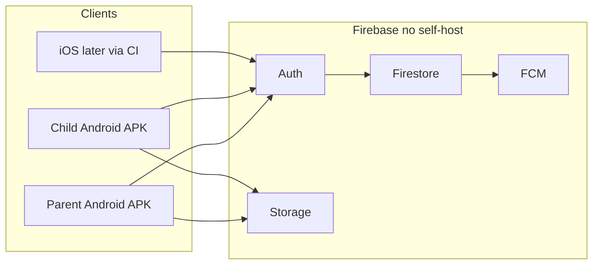

# Family Connect — Product & Build Plan

> **Agent rule:** Read this file before coding. Follow the current phase. Update checklists when work ships. Do not skip ahead to later phases until the current phase checklist is Done.

---

## 1. Product summary

**Family Connect** is a mobile app for families to chat, manage shared to-dos, assign tasks to children with notifications, and (later) share location — with **parent admin controls**.

| Role | Capabilities |
|------|----------------|
| **Parent (admin)** | Create family, invite members, assign tasks, manage members, view locations (when enabled), moderate family chat |
| **Child** | Join via invite code, chat, receive/complete tasks, share location when allowed |

**Invite flow:** Parent creates a family → shares an **invite code** → child creates an account and joins with that code.

**Distribution (now):** Install via **APK** (sideload). No self-hosted server. Sync runs through **Firebase**.

**Distribution (later):** iOS via cloud Mac CI (Codemagic / GitHub Actions); optional self-hosted API + PostgreSQL if Firebase is outgrown.

---

## 2. Chosen stack (locked)

| Layer | Choice | Why |
|--------|--------|-----|
| App | **Flutter** (Dart) | One codebase for Android + iOS; strong Windows toolchain for Android APKs |
| Backend (now) | **Firebase** | No server to deploy: Auth, Firestore, FCM, Storage, Security Rules |
| Auth | **Firebase Auth** | Email/password first; phone later |
| Database | **Cloud Firestore** | Real-time chat, tasks, members, location |
| Push | **Firebase Cloud Messaging (FCM)** | Notify children on task assign / chat |
| Files | **Firebase Storage** | Chat images (Phase 2+) |
| Location | **geolocator** + Firestore live updates | Share location between family members |
| Maps UI | **google_maps_flutter** (or equivalent) | Parent map view (Phase 2) |
| Local prefs | **shared_preferences** / **hive** | Theme, last family id, light offline cache |
| Future DB (optional) | **PostgreSQL** + NestJS/Node API | Only if you outgrow Firebase; keep schema documented for migration |

### Windows / iOS reality

- **Android:** Develop, run emulator, and ship **APK/AAB** fully on a Windows laptop.
- **iOS:** Same Flutter codebase on Windows, but **signing / IPA needs macOS**. Use **Codemagic** or GitHub Actions (macOS runner) for TestFlight/IPA — no Mac required for day-to-day coding.

### APK-only phase (no self-hosted server)

1. Create a Firebase project (Spark / free tier to start).
2. Register Android app → add `google-services.json`.
3. Register iOS app later → add `GoogleService-Info.plist`.
4. Build: `flutter build apk` → sideload on family phones.
5. All sync (chat, tasks, location, roles) goes through Firebase — no VPS to deploy.



---

## 3. Current status

| Field | Value |
|--------|--------|
| **App name** | Family Connect |
| **Current phase** | Phase 0 — Foundation |
| **Repo state** | Flutter scaffolded; Phase 0 code in place; await Firebase project wiring |
| **Deploy** | APK sideload only; Firebase backend |

Update this table when the active phase changes.

---

## 4. Feature roadmap & checklists

Status legend: `[ ]` Planned · `[~]` In progress · `[x]` Done

### Phase 0 — Foundation (current / first build)

- [x] Flutter project scaffold (`flutter create`)
- [x] Folder structure: `lib/features/{auth,family,chat,tasks,location,admin}/`
- [x] App theme + routing (e.g. go_router)
- [~] Firebase project wired (Android `google-services.json`) — code + docs ready; run FIREBASE_SETUP.md then set `isConfigured = true`
- [x] Firebase Auth — email/password sign up & sign in (requires Firebase config)
- [x] Roles: `parent` \| `child` stored on user profile
- [x] Create family (parent)
- [x] Join family via invite code (child)
- [x] Basic profile (display name; avatar placeholder)

### Phase 1 — Core family UX (current target after Phase 0)

- [ ] **Family chat** — group thread; text messages; timestamps; sender labels
- [ ] **To-do / tasks** — parent assigns to child(ren); title; optional due date; status `pending` \| `done`
- [ ] Child can mark own tasks done
- [ ] **Notifications** — FCM when a task is assigned (chat mention later)
- [ ] Parent **admin** screen — list members; remove member; regenerate invite code
- [ ] Firestore Security Rules for family-scoped access

### Phase 2 — Location & richer tasks (expected next)

- [ ] Location sharing toggle (per child / consent)
- [ ] Last-known (+ optional live) location written to Firestore
- [ ] Parent map view of children’s locations
- [ ] Task reminders / overdue badge
- [ ] Image attach in chat (Firebase Storage)
- [ ] Read receipts (optional)

### Phase 3 — Polish & future deploy (expected later)

- [ ] Parental controls: quiet hours, chat mute, location schedule
- [ ] Multiple families / guardians
- [ ] iOS CI build pipeline (Codemagic or GitHub Actions macOS)
- [ ] Document Firestore → PostgreSQL migration notes if self-hosting later
- [ ] Play Store / App Store packaging (when ready)

---

## 5. Suggested `lib/` layout (for agents)

```
lib/
  main.dart
  app.dart
  core/           # theme, router, firebase bootstrap, constants
  features/
    auth/
    family/
    chat/
    tasks/
    location/
    admin/
  shared/         # widgets, models used across features
```

Prefer feature-first folders. Keep Firebase access behind small repositories/services per feature.

---

## 6. Firestore data model (sketch)

| Path | Fields (initial) |
|------|------------------|
| `users/{uid}` | `name`, `role`, `familyId`, `fcmTokens[]`, `createdAt` |
| `families/{familyId}` | `name`, `inviteCode`, `createdBy`, `createdAt` |
| `families/{familyId}/members/{uid}` | `role`, `displayName`, `joinedAt` |
| `families/{familyId}/messages/{messageId}` | `text`, `senderId`, `createdAt` |
| `families/{familyId}/tasks/{taskId}` | `title`, `assigneeIds[]`, `status`, `dueAt`, `createdBy`, `createdAt` |
| `families/{familyId}/locations/{uid}` | `lat`, `lng`, `updatedAt`, `sharingEnabled` |

### Security Rules (intent)

- Only authenticated users with matching `familyId` membership may read/write that family’s data.
- Only **parents** may create/update/delete tasks, manage members, regenerate invite codes.
- Children may update their own task status (to `done`) and their own location doc when sharing is enabled.
- Messages: family members can create; optionally only parents can delete.

Keep rules in `firestore.rules` when the Flutter/Firebase project exists. Tighten before any public distribution.

---

## 7. Build & distribute (Windows)

```bash
# After Flutter + Firebase are set up
flutter pub get
flutter run                 # device or emulator
flutter build apk           # release APK for sideload
# optional:
flutter build appbundle     # Play Store later
```

**Do not commit secrets.** Prefer documenting local placement of `google-services.json` / `GoogleService-Info.plist`. If committed for private family use only, treat the repo as private and never publish API keys publicly.

---

## 8. Future deploy path (optional)

| Stage | Approach |
|--------|----------|
| Now | Firebase only; APK sideload |
| iOS | Same app + Codemagic / GHA macOS → IPA / TestFlight |
| Self-host later | NestJS (or similar) + **PostgreSQL**; map collections above to tables; keep FCM or replace with self-managed push |

Do **not** start a custom backend until Phase 1–2 Firebase product is stable unless requirements force it.

---

## 9. Agent workflow

1. **Read this `plan.md`** at the start of every session.
2. Check **§3 Current status** and the active phase checklist in **§4**.
3. Implement only work that advances the **current phase** (or clearly marked bugfixes).
4. After finishing a checklist item, mark it `[x]` (or `[~]` if partial) in this file.
5. When a phase is fully `[x]`, bump **Current phase** in §3 to the next phase.
6. Prefer `lib/features/{auth,family,chat,tasks,location,admin}/`.
7. Do not invent Phase 2–3 features mid–Phase 0/1 without updating this plan first and getting user confirmation.
8. Never commit Firebase secrets carelessly; respect `.gitignore` for local credentials when added.

---

## 10. Out of scope (for now)

- Web or desktop as primary targets
- Self-hosted servers / Docker in Phase 0–1
- Phone auth, payments, social login
- School / SZABIST-specific LMS features (this product is family messaging + chores)

---

*Last updated: 2026-10-12 — Phase 0 app scaffold + auth/family flows implemented; Firebase console wiring pending.*
)
